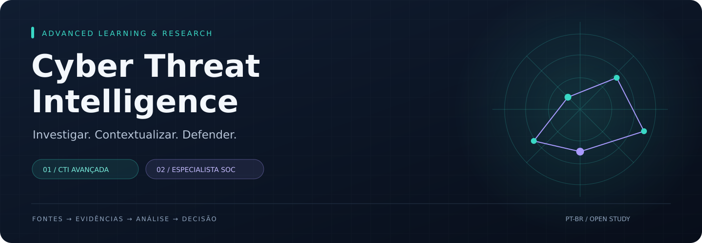
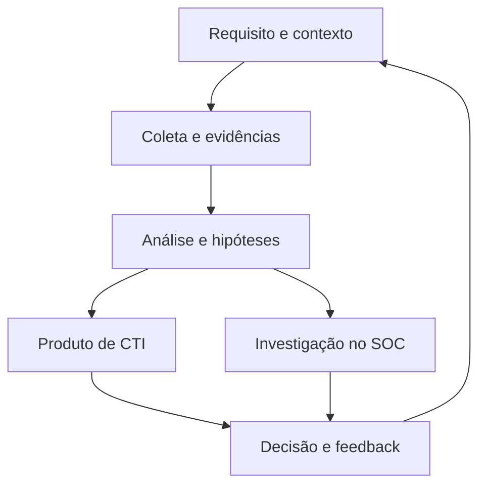

<p align="center"></p>
<p align="center"><strong>Uma formação aberta para transformar evidências em decisões defensivas.</strong><br/>CTI • Engenharia de coleta • Infraestrutura adversária • Operações de SOC</p>
<p align="center"><a href="learning-paths/cti-48-semanas.md"><strong>INICIAR CTI</strong></a> · <a href="learning-paths/soc-especialista.md"><strong>EXPLORAR SOC</strong></a> · <a href="labs/README.md">LABORATÓRIOS</a> · <a href="resources/catalog.json">REFERÊNCIAS</a></p>


## Escolha seu percurso

<table><tr><td width="50%" valign="top">

### 01 / CTI avançada
**48 semanas · 576 horas propostas**

Descubra fontes, construa coleta confiável, investigue infraestrutura e produza inteligência útil ao negócio.

[Ver plano semanal →](learning-paths/cti-48-semanas.md)

</td><td width="50%" valign="top">

### 02 / Especialista em SOC
**24 semanas · 288 horas propostas**

Aprofunde investigação, SIEM/SOAR, malware, riscos, operação de serviços e liderança técnica.

[Ver competências e desafios →](learning-paths/soc-especialista.md)

</td></tr></table>

> **Primeiro passo:** faça o [diagnóstico](assessments/diagnostico.md). As durações são estimativas de estudo a 12 h/semana, não certificação ou garantia de senioridade. A trilha SOC é complementar: cursar ambas integralmente soma 864 horas; equivalências exigem evidência prática.

## Uma jornada, entregas verificáveis

| Etapa | Pergunta | Evidência de aprendizado |
|---|---|---|
| Direcionar | Qual decisão precisa de inteligência? | PIR e plano de coleta |
| Investigar | O que as fontes realmente sustentam? | Registro de evidências e hipóteses |
| Construir | A coleta permanece confiável após falhas? | Pipeline reproduzível e runbook |
| Defender | Como validar uma oportunidade de detecção? | Consulta, teste e limitações |
| Comunicar | O que deve mudar e por quê? | Relatório, briefing e feedback |



## Mesa de trabalho

| Acesso | O que você encontra |
|---|---|
| [Módulos CTI](modules/README.md) | 12 unidades com leituras, prática e aprovação |
| [Laboratórios](labs/README.md) | SQL e coleta executáveis; exercícios guiados de análise e operação |
| [Templates](templates/README.md) | Fontes, evidências, MAR, incidente, risco e serviços |
| [Avaliação](assessments/rubrica.md) | Critérios objetivos e revisão por pares |
| [Projeto final](capstones/cti-soc.md) | Campanha fictícia do PIR ao handover |
| [Normas e RFCs](docs/09-normas-e-rfcs.md) | Referências da trilha SOC, escopo e ressalvas de versão |
| [Bibliografia aplicada](docs/10-bibliografia-aplicada.md) | O que ler, para quê e como praticar |

## Biblioteca de fundamentos

[Fundamentos](docs/01-fundamentos.md) · [Métodos](docs/02-metodologia.md) · [Fontes e ferramentas](docs/03-fontes-e-ferramentas.md) · [Trilhas introdutórias](docs/04-trilhas.md) · [Estudos de caso](docs/05-estudos-de-caso.md) · [Relatórios](docs/06-relatorios.md) · [Geopolítica e atribuição](docs/07-geopolitica-e-atribuicao.md) · [Auditoria e créditos](docs/08-auditoria-e-creditos.md)

## Conexões com o ecossistema

| Projeto | Aprofundamento complementar |
|---|---|
| [ThreatHunting](https://github.com/Ridd1kulusC0d3r/ThreatHunting) | Hipóteses e investigação em telemetria |
| [detectionengineer](https://github.com/Ridd1kulusC0d3r/detectionengineer) | Engenharia de detecção |
| [ToolsGuide](https://github.com/Ridd1kulusC0d3r/ToolsGuide) | Guias de ferramentas |
| [MITRE](https://github.com/Ridd1kulusC0d3r/MITRE) | Ecossistema e modelos defensivos |
| [OSINTAI](https://github.com/Ridd1kulusC0d3r/OSINTAI) | IA aplicada à investigação |

As conexões são caminhos de aprofundamento; os laboratórios locais não dependem desses projetos.

## Qualidade e contribuição

```bash
python3 scripts/validate_catalog.py
python3 scripts/validate_learning.py
python3 scripts/run_soc_lab.py
python3 scripts/collect_fixture.py --self-test
```

A validação local verifica estrutura, navegação e resultados dos exercícios. Não atesta disponibilidade de todas as fontes externas ou eficácia em produção. Veja [como contribuir](CONTRIBUTING.md).

**Escopo:** formação, pesquisa defensiva e laboratórios reproduzíveis. Os dados locais são sintéticos; não distribuímos malware executável, credenciais ou dados vazados. Atribuição exige evidência e revisão. Guias de análise dinâmica usam ambientes isolados autorizados e não fornecem amostras reais.

**Créditos:** preservamos a curadoria inspirada em [Daniel Donda](https://github.com/danieldonda/Cyber-Threat-Intelligence) e [Sh4dow-BR](https://github.com/Sh4dow-BR/linkscyberthreatintelligence). [Proveniência editorial](docs/08-auditoria-e-creditos.md). [Sistema visual](assets/README.md).
