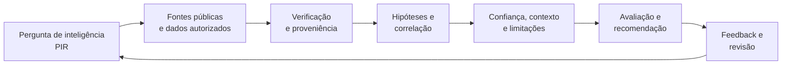
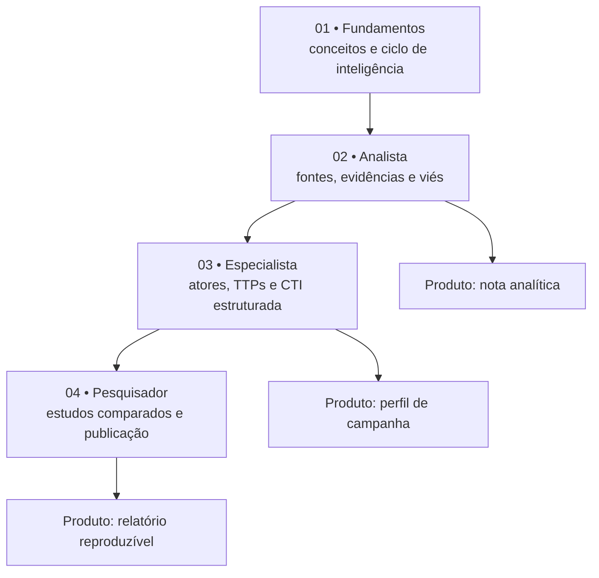

<p align="center">
  
</p>

<p align="center">
  <strong>Inteligência de ameaças vai além de colecionar indicadores.</strong><br />
  Uma biblioteca aberta, em português, para transformar fontes públicas em análises fundamentadas e decisões defensivas.
</p>

<p align="center">
  <a href="docs/01-fundamentos.md">Fundamentos</a> ·
  <a href="docs/02-metodologia.md">Métodos</a> ·
  <a href="docs/03-fontes-e-ferramentas.md">Fontes & ferramentas</a> ·
  <a href="docs/04-trilhas.md">Trilhas</a> ·
  <a href="docs/05-estudos-de-caso.md">Estudos de caso</a> ·
  <a href="docs/06-relatorios.md">Relatórios</a>
</p>


> **Missão:** reunir recursos de alto valor, ensinar por que eles importam e mostrar como produzir inteligência verificável. Não somos um feed ao vivo, um scanner, um pacote de exploits ou uma plataforma operacional de CTI.

## 🧭 Comece aqui

| Quero aprender... | Material | Entrega prática |
|:--|:--|:--|
| O que CTI realmente significa | [01 · Fundamentos](docs/01-fundamentos.md) | Diferenciar fato, indicador, hipótese e inteligência |
| Como pensar como analista | [02 · Métodos e qualidade analítica](docs/02-metodologia.md) | Plano de coleta e avaliação de evidências |
| Onde estão as melhores fontes | [03 · Biblioteca de fontes e ferramentas](docs/03-fontes-e-ferramentas.md) | Curadoria por finalidade e maturidade |
| Como evoluir do básico ao avançado | [04 · Trilhas de estudo](docs/04-trilhas.md) | Quatro trilhas com exercícios e critérios de conclusão |
| Como aplicar o aprendizado | [05 · Estudos de caso](docs/05-estudos-de-caso.md) | Cenários de análise não operacional, com incertezas |
| Como apresentar uma avaliação | [06 · Relatórios](docs/06-relatorios.md) | Template com evidências, confiança e limitações |
| Como estudar atores e geopolítica | [07 · Geopolítica e atribuição](docs/07-geopolitica-e-atribuicao.md) | Matriz de hipóteses e regras contra atribuição precipitada |
| Por que alguns links ficaram de fora | [08 · Auditoria e créditos](docs/08-auditoria-e-creditos.md) | Rastreabilidade de origem e decisão editorial |

## 🧠 Da informação à inteligência



**Regra central:** IOC não é sinônimo de inteligência. Um endereço IP, sozinho, não prova intenção, autoria ou impacto. O contexto e a rastreabilidade são mais valiosos do que o volume de artefatos.

## 🗂️ Mapa do acervo

| Área | Abrange | Fonte de referência |
|:--|:--|:--|
| CTI estratégica | risco, motivação, setor, geopolítica | [CISA](https://www.cisa.gov/), [FIRST](https://www.first.org/) |
| CTI operacional | campanhas, objetivos, atividade observada | [MITRE ATT&CK](https://attack.mitre.org/), [APTnotes](https://github.com/kbandla/APTnotes) |
| CTI tática/técnica | comportamentos, observáveis, detecção | [ATT&CK STIX](https://github.com/mitre-attack/attack-stix-data), [SigmaHQ](https://github.com/SigmaHQ/sigma) |
| Compartilhamento | STIX, TAXII, TLP, MISP e OpenCTI | [OASIS](https://oasis-open.github.io/cti-documentation/), [MISP](https://www.misp-project.org/) |
| Investigação e aprendizado | pensamento crítico, fontes abertas, estudos | [MITRE CTI Training](https://attack.mitre.org/resources/training/cti/), [Threat Hunter Playbook](https://github.com/OTRF/ThreatHunter-Playbook) |

## 🎯 Trilhas de progressão



A jornada detalhada com exercícios de análise e entregáveis está em [docs/04-trilhas.md](docs/04-trilhas.md).

## 🔎 Seleção inicial de alto valor

| Recurso | Por que está aqui | Uso recomendado |
|:--|:--|:--|
| [MITRE ATT&CK](https://attack.mitre.org/) | Linguagem comum para comportamento adversário | Mapear somente comportamentos sustentados por evidência |
| [ATT&CK CTI Training](https://attack.mitre.org/resources/training/cti/) | Módulos oficiais de interpretação de relatórios | Começar pelo mapeamento de narrativas |
| [OASIS CTI](https://oasis-open.github.io/cti-documentation/) | Especificações STIX/TAXII | Padronizar informações, sem confundir formato com qualidade |
| [FIRST TLP 2.0](https://www.first.org/tlp/) | Regras de compartilhamento | Verificar restrições antes de redistribuir |
| [CISA KEV](https://www.cisa.gov/known-exploited-vulnerabilities-catalog) | Vulnerabilidades com exploração observada | Complementar priorização baseada em contexto |
| [MISP](https://github.com/MISP/MISP) | Gestão e intercâmbio de CTI | Estudar eventos, taxonomias e correlação |
| [OpenCTI](https://github.com/OpenCTI-Platform/opencti) | Relações entre entidades e observáveis | Explorar proveniência e modelagem STIX |
| [APTnotes](https://github.com/kbandla/APTnotes) | Coleção de relatórios públicos sobre campanhas | Construir cronologias e conferir fontes primárias |

Veja a [biblioteca comentada](docs/03-fontes-e-ferramentas.md) e o [catálogo JSON](resources/catalog.json) para a seleção completa.

## 🧪 Exemplo do método

**Cenário inteiramente fictício:** várias empresas de um setor recebem mensagens que imitam fornecedores. Um relatório menciona uma possível campanha coordenada.

| Etapa | Pergunta | Resultado esperado |
|:--|:--|:--|
| Requisito | O que a organização precisa decidir? | Priorizar validação de domínios e conscientização |
| Coleta | Quais fontes independentes corroboram? | Relatos públicos, avisos oficiais e cronologia |
| Análise | Campanha coordenada ou episódios isolados? | Duas hipóteses, com fatos pró e contra |
| Avaliação | Quão forte é a conclusão? | Confiança justificada, pontos desconhecidos |
| Produto | O que fazer e como medir? | Nota analítica com ações defensivas proporcionais |

O caso completo está em [estudos de caso](docs/05-estudos-de-caso.md). Nenhum indicador apresentado aqui corresponde a um alvo real.

## 📦 Estrutura do projeto

```text
CyberThreatIntelligence/
├── assets/                  Identidade visual
├── docs/                    Teoria, guias, trilhas e casos
├── resources/catalog.json   Catálogo legível por software
├── scripts/                 Validação local do catálogo
├── .github/workflows/       Checagem automática em contribuições
├── CONTRIBUTING.md          Padrões editoriais
└── README.md                Navegação principal
```

Para conferir a integridade estrutural do acervo:

```bash
python3 scripts/validate_catalog.py
```

A validação verifica campos, duplicatas e formato de URLs; **não** garante a disponibilidade em tempo real de sites externos.

## 🤝 Autoria, escopo e ética

O material explicativo é escrito para este projeto, com referências e atribuições explícitas. Inspiramo-nos na organização e na seleção de temas de [Daniel Donda](https://github.com/danieldonda/Cyber-Threat-Intelligence) e [Sh4dow-BR](https://github.com/Sh4dow-BR/linkscyberthreatintelligence), sem copiar os seus textos. Consulte a [auditoria de fontes](docs/08-auditoria-e-creditos.md).

Publicamos **conteúdo de aprendizado, análise responsável e pesquisa defensiva**. Não republicamos amostras de malware, dados pessoais vazados, credenciais, exploits ou diretórios de mercados ilícitos. Toda atribuição é tratada como hipótese graduada, não como certeza automática. O catálogo foi revisado editorialmente em **18/10/2026**, mas disponibilidade e manutenção externas exigem revisões periódicas.

> **Contribuições:** leia [CONTRIBUTING.md](CONTRIBUTING.md). Uma referência só entra se tiver finalidade clara, autoria/proveniência identificável e benefício real para estudo de CTI.
