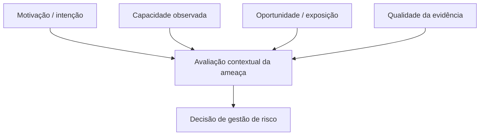

# 01 · Fundamentos de Cyber Threat Intelligence

> **Objetivo:** entender o que caracteriza inteligência e por que dados coletados isoladamente não bastam.

[← Início](../README.md) · [Próximo: metodologia →](02-metodologia.md)

## O que é CTI?

**Cyber Threat Intelligence (CTI)** é conhecimento construído mediante coleta, avaliação e análise de informações sobre ameaças cibernéticas, direcionado a perguntas e decisões de segurança. **OSINT** é uma categoria de fontes e métodos; não se confunde com a etapa final de inteligência.

**Exemplo simples:** uma base contém 200 domínios suspeitos (dados); três domínios são relacionados à mesma campanha em diferentes relatórios (informação correlacionada); a campanha é relevante para um setor específico e exige uma ação prioritária (inteligência contextualizada).

## Tipos de produto de inteligência

| Nível | Pergunta típica | Público | Produto |
|:--|:--|:--|:--|
| Estratégico | Como o cenário de ameaças afeta a organização nos próximos meses? | Gestão e risco | Avaliação setorial, cenários e exposição |
| Operacional | Que campanhas e objetivos podem afetar nossas operações? | CTI e resposta | Perfil de campanha, cronologia, avaliação de impacto |
| Tático | Que comportamentos e TTPs têm suporte empírico? | Threat hunting e detecção | Hipóteses de comportamento, mapeamentos ATT&CK |
| Técnico | Quais observáveis foram confirmados e em qual período? | Analistas e ferramentas | Indicadores com contexto e validade temporal |

**Observação:** taxonomias variam entre organizações. O nível técnico pode ser tratado como parte da CTI tática.

## Conceitos indispensáveis

- **Threat actor:** ator ou conjunto de atores associados a comportamento malicioso; nomes de fornecedores podem apontar agrupamentos diferentes.
- **Campanha:** conjunto de atividades relacionadas por objetivo, infraestrutura, período ou procedimentos, conforme evidências.
- **IOC:** observável associado a possível atividade maliciosa. Relevância e validade precisam de contexto.
- **IOA / comportamento:** sinal de uma atividade ou sequência de ações; pode sobreviver a trocas rápidas de infraestrutura.
- **TTP:** tática, técnica e procedimento. No ATT&CK, táticas expressam o objetivo adversário; técnicas, o comportamento observado.
- **PIR (Priority Intelligence Requirement):** pergunta de inteligência prioritária ligada a uma decisão.
- **Confiança analítica:** qualidade do suporte evidencial de uma avaliação. Não equivale à gravidade.
- **Atribuição:** inferência sobre autoria ou responsabilidade, sujeita a ambiguidade, interferência e falsas pistas.

## Ameaça não é sinônimo de vulnerabilidade

Motivação, capacidade e oportunidade são variáveis úteis ao raciocínio sobre ameaças. Não formam uma equação mecânica nem provam que um ataque acontecerá.

**Exercício:** descreva uma organização fictícia que dependa de serviços em nuvem. Formule um PIR, duas fontes públicas possíveis, um tipo de evidência a procurar e uma limitação da análise.

## Distinguir fato, hipótese e julgamento

| Declaração | Classificação |
|:--|:--|
| Um boletim oficial confirmou uma vulnerabilidade explorada | Fato atribuído a uma fonte verificável |
| Duas campanhas compartilham ferramentas, logo são a mesma operação | Hipótese que exige evidências adicionais |
| Há risco relevante para empresas que utilizam a tecnologia afetada | Avaliação condicionada à exposição e ao contexto |
| Um ator específico está por trás de um incidente porque um IP apareceu em relatórios | Atribuição insuficientemente sustentada |

### Leituras primárias

- [MITRE ATT&CK](https://attack.mitre.org/): conceitos de táticas, técnicas, grupos e software.
- [MITRE CTI Training](https://attack.mitre.org/resources/training/cti/): abordagem didática com exercícios.
- [CISA](https://www.cisa.gov/): avisos e publicações defensivas.
- [FIRST](https://www.first.org/): padrões de resposta, coordenação e compartilhamento.

> **Resumo Feynman:** se você não consegue explicar a alguém qual decisão muda depois de ler seu relatório, provavelmente produziu uma coleção de dados, não uma avaliação de inteligência.
