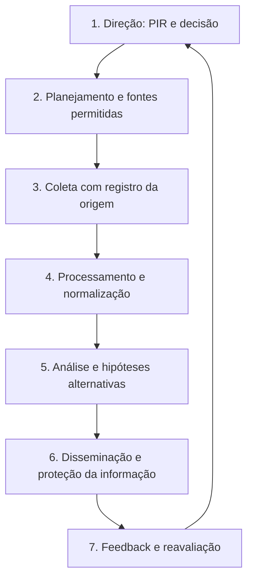

# 02 · Método analítico e qualidade de evidências

> **Objetivo:** fazer uma análise reproduzível, que admita incertezas e reduza conclusões precipitadas.

[← Fundamentos](01-fundamentos.md) · [Próximo: fontes →](03-fontes-e-ferramentas.md)

## Ciclo de inteligência para CTI



| Fase | Controle mínimo de qualidade |
|:--|:--|
| Direção | Quem decide o quê, até quando, com qual tolerância ao erro? |
| Coleta | Fonte, URL, data de acesso, data do evento, escopo e limitações |
| Processamento | Evitar duplicatas; separar observável, interpretação e citação |
| Análise | Formular explicações concorrentes, registrar sinais contrários |
| Disseminação | Usar TLP corretamente; explicar recomendações e incerteza |
| Feedback | Verificar utilidade, correções e necessidade de atualização |

## Crítica de fontes

**Perguntas obrigatórias:** quem publicou? A fonte observou diretamente ou republicou outra? Ela apresenta método e datas? Qual é o incentivo para distorção? Há fontes independentes? O artigo foi corrigido? A conclusão é mais forte que os dados?

Para cada alegação central, registre:
- **Origem primária:** publicação original, advisory, telemetria divulgada de forma legítima ou relatório metodologicamente explícito.
- **Corroboração:** outra fonte independente, não apenas um blog citando o mesmo blog.
- **Contexto:** setor, ambiente, período e escopo da observação.
- **Contradições:** evidências e explicações alternativas.
- **Revisão:** condição que faria a conclusão ser alterada.

## Análise de hipóteses concorrentes (ACH simplificada)

**Exemplo fictício:** mensagens fraudulentas aparecem em três organizações.

| Evidência hipotética | H1: campanha coordenada | H2: imitação oportunista | H3: coincidência |
|:--|:--:|:--:|:--:|
| Textos quase idênticos | Compatível | Compatível | Pouco compatível |
| Mesma janela temporal | Compatível | Compatível | Possível |
| Infraestrutura compartilhada **com fonte confirmada** | Compatível | Menos compatível | Pouco compatível |
| Amostra pequena e visibilidade incompleta | Não discrimina | Não discrimina | Não discrimina |

Essa tabela **não mede probabilidade**. Seu valor é explicitar o que distingue hipóteses e descobrir quais evidências ainda faltam. Evite contar linhas como votos.

## Confiança ≠ probabilidade ≠ severidade

- **Confiança:** força, independência e consistência do conjunto de fontes (baixa, moderada, alta com justificativa).
- **Probabilidade:** estimativa de ocorrência de um cenário futuro, quando há base para isso.
- **Severidade/impacto:** consequência possível para a organização.
- **Urgência:** necessidade temporal de ação.

Um incidente potencialmente grave pode ter atribuição com confiança baixa. Não infle a certeza para parecer convincente.

## Modelos complementares

| Modelo | Uso correto | Armadilha comum |
|:--|:--|:--|
| [ATT&CK](https://attack.mitre.org/) | Descrever comportamentos conhecidos | Mapear técnicas apenas por palavras-chave |
| [D3FEND](https://d3fend.mitre.org/) | Explorar contramedidas defensivas | Supor que toda contramedida serve a todo contexto |
| [Diamond Model](https://www.activeresponse.org/wp-content/uploads/2013/07/diamond.pdf) | Relacionar adversário, capacidade, infraestrutura e vítima | Atribuir identidade por uma única relação |
| [Pyramid of Pain](https://www.sans.org/tools/the-pyramid-of-pain/) | Pensar na durabilidade de indicadores | Tratar a pirâmide como pontuação universal |
| [STIX 2.1](https://oasis-open.github.io/cti-documentation/) | Representar entidades e relacionamentos | Assumir que estrutura implica veracidade |
| [TLP 2.0](https://www.first.org/tlp/) | Determinar restrições de compartilhamento | Confundir TLP com nível de classificação ou licença |

## Exemplo de cartão de evidência

```yaml
id: EVD-001
alegacao: "Há relatos públicos de mensagens fraudulentas semelhantes."
tipo: observacao_relacional
fonte_primaria: "URL do relatório original"
publicado_em: "AAAA-MM-DD"
acessado_em: "AAAA-MM-DD"
independencia: "A verificar"
confianca: "Moderada - justificada no relatório"
alternativa: "Possível reutilização de modelo de fraude"
limitacao: "Somente três relatos; sem amostragem representativa"
```

**Nota:** este exemplo é ilustrativo e não valida nenhuma campanha real.

## Limites éticos

Use informações públicas ou dados cujo acesso seja autorizado; minimize dados pessoais e respeite TLP e direitos autorais. Não inclua instruções para obtenção de credenciais, cópias de bases vazadas ou repositórios de malware como fonte de estudo inicial.

### Produto de aprendizagem

Redija uma nota de **até uma página** com PIR, três fontes, duas hipóteses, limitação-chave, nível de confiança justificado e recomendação concreta.

