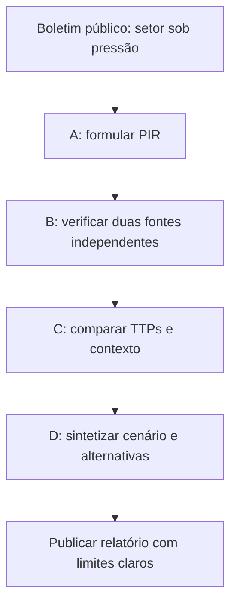

# 04 · Trilhas de estudo progressivas

[← Biblioteca](03-fontes-e-ferramentas.md) · [Casos →](05-estudos-de-caso.md)

> **Formação avançada:** [CTI — 48 semanas](../learning-paths/cti-48-semanas.md) · [Especialista SOC — 24 semanas](../learning-paths/soc-especialista.md) · [Laboratórios](../labs/README.md). As trilhas abaixo permanecem como portas de entrada introdutórias.

Cada trilha tem objetivo, prática e prova de aprendizado. Os tempos são livres: avance pelo que consegue explicar e produzir, não pelo número de vídeos assistidos.

## Trilha A · Iniciante | Aprender a perguntar

**Conteúdos:** CTI x OSINT x threat hunting; PIR; IOC x TTP; dados x conhecimento; tipos de produto.  
**Leitura:** [Fundamentos](01-fundamentos.md), [MITRE CTI Training](https://attack.mitre.org/resources/training/cti/), [Katie Nickels](https://medium.com/katies-five-cents/a-cyber-threat-intelligence-self-study-plan-part-1-968b5a8daf9a).  
**Prática:** invente uma organização fictícia e escreva três PIRs, cada um associado a uma decisão.  
**Critério de conclusão:** diferenciar um observável de uma conclusão e explicar duas limitações de um feed.

## Trilha B · Analista | Julgar evidências

**Conteúdos:** ciclo de inteligência, proveniência, datas, confiabilidade, corroboração independente, viés, hipóteses alternativas e nível de confiança.  
**Leitura:** [Método](02-metodologia.md), [APTnotes](https://github.com/kbandla/APTnotes), [FIRST TLP](https://www.first.org/tlp/).  
**Prática:** escolha um advisory público e compare duas análises que o citam. Registre o que cada fonte de fato observou.  
**Critério de conclusão:** produzir nota de uma página, com atribuições explícitas e pelo menos uma evidência que contradiz sua hipótese principal.

## Trilha C · Especialista | Conectar modelos e resposta

**Conteúdos:** ATT&CK, modelo de diamante, STIX/TAXII, MISP, OpenCTI, TLP, TTPs e contexto setorial.  
**Leitura:** [ATT&CK CTI](https://attack.mitre.org/resources/training/cti/), [OASIS](https://oasis-open.github.io/cti-documentation/), [MISP](https://github.com/MISP/MISP), [OpenCTI](https://github.com/OpenCTI-Platform/opencti).  
**Prática:** pegue uma narrativa pública e identifique **somente** comportamentos diretamente descritos; justifique cada mapeamento.  
**Critério de conclusão:** entregar um perfil de campanha com cronologia, relações, confiança, lacunas e recomendações para defesa.

## Trilha D · Pesquisador | Produzir análise auditável

**Conteúdos:** revisão de literatura, comparação de campanhas, métodos estruturados, disputa de narrativas, limitação de fontes e publicação responsável.  
**Leitura:** [Geopolítica](07-geopolitica-e-atribuicao.md), [Template de relatório](06-relatorios.md), [OASIS CTI](https://oasis-open.github.io/cti-documentation/).  
**Prática:** propor uma pergunta de pesquisa, explicar método de seleção de fontes e testar duas hipóteses opostas.  
**Critério de conclusão:** relatório reproduzível com referências primárias, critérios de exclusão e seção de incerteza.

## Jornada de estudo: uma investigação fictícia

### Quatro perguntas para autoavaliação

1. O que faria meu relatório mudar de conclusão?
2. Qual fonte é primária e qual apenas repetiu a informação?
3. Que parte do argumento é observação e que parte é interpretação?
4. Quem tomará a decisão e o que precisa saber primeiro?

> **Estratégia de estudo:** um pequeno relatório bem fundamentado vale mais do que dezenas de links salvos sem leitura.

